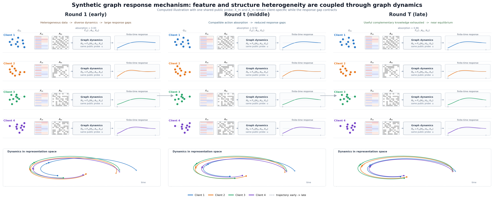

Graph Dynamics Research Workspace

# 图动力学算法设计

从异质图传播轨迹中学习可解释、可验证、可迁移的动力学知识。

[进入 Method V1.0](methodv10.md){ .md-button .md-button--primary }
[查看 ResKoopNet 审计](references/reskoopnet.md){ .md-button }
[回看 Method V0.4](methodv04.md){ .md-button }
[进入 Method V0.5](methodv05.md){ .md-button }
[查看 V0.3 实验分析](experiments/methodv03.md){ .md-button }
[查看 KoopmanGraph 审计](references/koopmangraph.md){ .md-button }
[回看 Method V0.2](methodv02.md){ .md-button }
[回看 Method V0.1](methodv01.md){ .md-button }
[回看 Method V0](methodv0.md){ .md-button }
[浏览参考论文](references/index.md){ .md-button }

<strong>07</strong>方法版本

<strong>09</strong>参考条目

<strong>05</strong>实验页面

<strong>01</strong>固定研究主线

## 工作区

CURRENT METHOD

### [Method V1.0](methodv10.md)

保留每个客户端的本地 FedDGN backbone，以 ResKoopNet 从传播轨迹学习本地 Koopman 算子；服务端通过 functional map 把独立 observable 空间中的 modes 对齐到公共比较空间，随后构建 mode graph、发现动力学社区并形成全局 mode bank。V1.0 只做跨客户端 mode discovery，**尚不反馈或修改本地训练。**

[查看 V1.0 算法设计](methodv10.md){ .md-button .md-button--primary }
[查看 ResKoopNet 源码审计](references/reskoopnet.md){ .md-button }
[回看 V0.4 实验分析](experiments/methodv04.md){ .md-button }

DESIGN PRINCIPLE

### [Method V0.5](methodv05.md)

保留 V0.4 的 reference dynamics → Koopman generator 骨架，把低维动力学算子本身当作可交换的联邦知识载体：服务器不再构造唯一全局算子，而是在算子流形上为每个客户端形成**个性化、方向性**的知识流，并让外部驱动力在知识被吸收后自然衰减到异质性平衡。思想约束见「思想设计」，可编码的 server/client 流程见「实现步骤」。**尚未实现。**

[查看 V0.5 思想设计](methodv05.md){ .md-button }
[查看 V0.5 实现步骤](methodv05-implementation.md){ .md-button }

EVIDENCE BASE

### [Method V0](methodv0.md)

冻结 A-DGN 后拟合本地 Koopman 代理。V0 已验证主轨迹可以低维滚动，也暴露了扰动响应没有被保留的问题。

[回看 V0](methodv0.md){ .md-button }

READING LIBRARY

### [参考论文](references/index.md)

按“坐标学习 → 变分压缩 → 滚动纠偏 → 算子适配 → 图上连续算子 → 守恒与受控传播 → 谱残差”组织参考材料，逐项记录方法、源码证据和面向异质图联邦的可迁移边界。

[打开论文库](references/index.md){ .md-button }

MAINTENANCE

### [维护说明](guide/authoring.md)

统一维护 Markdown、LaTeX、图片、交互脚本和本地预览环境，后续算法方案可以直接追加页面。

[查看维护规范](guide/authoring.md){ .md-button }

## 当前研究主线

01<strong>本地动力学</strong><small>FedDGN → 传播轨迹</small>

→

02<strong>轨迹压缩</strong><small>ResKoopNet → $K_m,V_m$</small>

→

03<strong>功能对齐</strong><small>$C_mK_m\approx K_sC_m$</small>

→

04<strong>模式发现</strong><small>mode graph → mode bank</small>

## 一个可交互的线性动力学示例

下面的示例直接在 Markdown 页面中嵌入 HTML 和 JavaScript。拖动时间步，观察二维
潜态在固定线性算子下的轨迹；算法页面可以用同样方式嵌入实验图、参数滑块、
Canvas、SVG 或其他前端组件。

  

    <label for="demo-horizon">传播步数 <output data-horizon>12</output></label>
    <input id="demo-horizon" data-horizon-input type="range" min="0" max="32" value="12">
  

  <canvas data-dynamics-canvas width="900" height="320" aria-label="二维潜态线性动力学轨迹"></canvas>
  

## 页面能力

| 内容 | 写法 | 用途 |
| --- | --- | --- |
| 数学公式 | LaTeX 的 `$...$` 或 `$$...$$` | 定义动力系统、损失函数和约束 |
| 图片 | Markdown 图片或 HTML `figure` | 放置机制图、实验图和截图 |
| 布局 | Markdown 网格、属性和少量 HTML | 组织模块卡片、对照实验和结果 |
| 交互 | 页面中的 HTML + `docs/javascripts/` | 滑块、动画、Canvas、可视化组件 |
| 代码 | fenced code block | 展示实现和伪代码 |

例如，线性潜空间传播可以直接写成：

$$
z_{t+1}=Kz_t, \qquad \widehat{H}_{t+s}=D_\psi(K^s z_t, G).
$$

<figure markdown="span">
  { width="100%" }
  <figcaption>本地图片会随站点一起构建，不依赖外部图片链接。</figcaption>
</figure>
