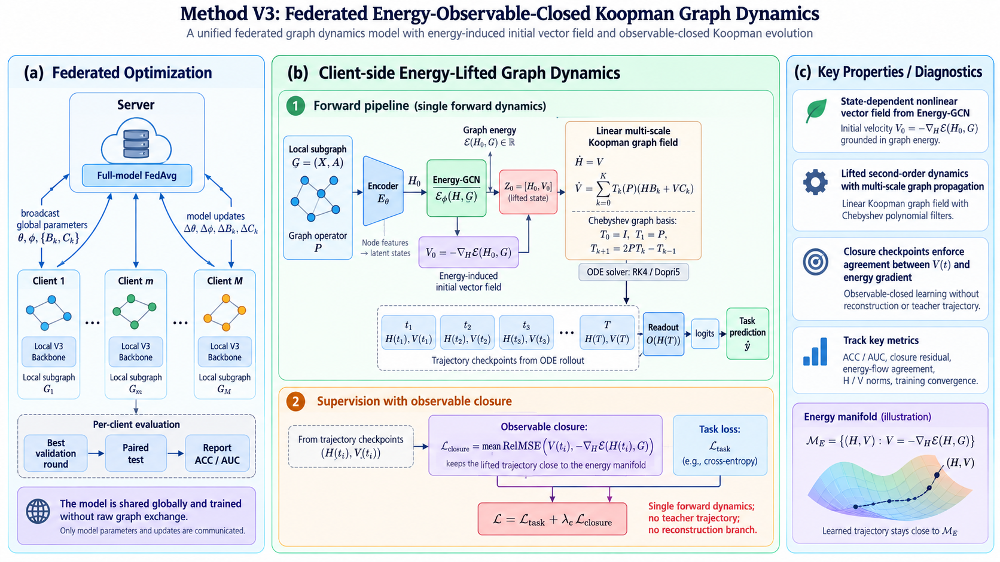

# Method V0.3：能量观测闭合的 Koopman 图动力学

!!! warning "研究状态：V0.3 暂停，转入 V0.4"
    V0.3 的设计与实现已经完成第一轮对齐，但完整 `main.py` local 结果最高为
    **74.12% ACC ± 13.25%**，尚未达到约 80% 的本地主干门槛；直接 FedAvg 也尚未启动。
    受控筛选提示当前问题集中在 Energy-GCN 初始向量场、closure 尺度和 Koopman rollout
    的耦合稳定性。详细证据见[实验分析](experiments/methodv03.md)。V0.4 的最新正式
    入口已改为任务锚定神经图向量场、stop-gradient Lie/JVP 闭合与稳定 Bernstein
    Graph-Koopman generator；不再构造 teacher/native snapshots。

!!! abstract "当前研究决策"
    V0.3 不再采用“先训练一个 ODE-GNN 教师，再让 Koopman 代理拟合教师轨迹”的两阶段串行方案，也不退回 V0.1/V0.2 的简单 $ZA_0+PZA_1$ 一阶线性传播。当前首选是**单条动力学 + 能量观测 + Koopman 闭合**：Energy-GCN 根据当前图状态定义非线性向量场，Koopman 线性生成元直接承担最终传播，二者通过同一 observable manifold 保持一致。后续联邦阶段直接更新 Koopman generator，而不是把聚合结果蒸馏回另一套本地 GNN。

[回看 V0](methodv0.md){ .md-button }
[回看 V0.1](methodv01.md){ .md-button }
[查看 V0.3 实验分析](experiments/methodv03.md){ .md-button }
[进入 Method V0.4](methodv04.md){ .md-button .md-button--primary }

<figure markdown="span">
  { width="100%" }
  <figcaption>Method V0.3 总体框架：服务器通过 FedAvg 聚合模型参数；客户端由 Energy-GCN 定义能量诱导初始向量场，再用多尺度 Koopman 图场进行单条连续动力学演化，并通过能量梯度闭合约束和任务损失联合训练。</figcaption>
</figure>

## 1. 为什么 V0.3 要重新定义“本地图动力学”

V0 到 V0.2 一直存在一个根本困难：静态节点分类图没有天然时间序列，因此如果严格遵循传统 Koopman system identification，需要先人为得到一条“真实动力学轨迹”：

$$
H(0),H(t_1),\ldots,H(T),
$$

再学习一个线性算子去复现这条轨迹。最直接的做法是先训练一套 nonlinear ODE-GNN，再把它冻结为教师；但这样会重新产生 V0 已经暴露的问题：

1. **模型重复**：一个 nonlinear ODE-GNN 负责产生轨迹，另一个 Koopman GNN 负责模仿；
2. **故事退化**：进入联邦后很容易变成“聚合 Koopman teacher，再蒸馏 local GNN”；
3. **训练目标错位**：最终任务模型与被共享的动力学代理不是同一个系统；
4. **动态图目标循环**：若教师继续更新，Koopman 识别对象本身也随之变化。

另一方面，V0.1/V0.2 直接使用

$$
\dot Z=ZA_0+PZA_1
$$

虽然简洁，但空间传播只有 $I$ 与 $P$ 两个基，本质接近 continuous residual GCN；如果 observable lifting 不够强，表达能力很容易被限制。

因此 V0.3 的核心问题不再是：

> “如何给一个已经存在的 ODE-GNN 再训练一个 Koopman 代理？”

而是：

> **能否直接构造一条 task-useful graph flow，使它在学习得到的 observable space 中由线性 Koopman generator 演化，并且始终保持 observable closure？**

核心路线变成：

<div class="research-flow">
<div class="flow-step"><span>01</span><strong>节点状态</strong><small>$H_0=E_\theta(X)$</small></div>
<div class="flow-arrow" aria-hidden="true">→</div>
<div class="flow-step"><span>02</span><strong>能量观测</strong><small>$V_0=-\nabla_H\mathcal E_\omega(H_0,G)$</small></div>
<div class="flow-arrow" aria-hidden="true">→</div>
<div class="flow-step"><span>03</span><strong>Koopman 提升</strong><small>$Z_0=[H_0,V_0]$</small></div>
<div class="flow-arrow" aria-hidden="true">→</div>
<div class="flow-step"><span>04</span><strong>线性图流</strong><small>$\dot Z=\mathcal K_G Z$</small></div>
<div class="flow-arrow" aria-hidden="true">→</div>
<div class="flow-step"><span>05</span><strong>真实任务</strong><small>$R_\psi(H(T))$ → ACC/AUC</small></div>
</div>

这里从头到尾只有**一条实际 forward trajectory**。Energy-GCN 不单独积分第二条教师轨迹；它只定义 Koopman observable 所应满足的非线性状态关系。

---

## 2. V0.3 的核心思想：能量梯度不是教师，而是 Koopman observable

对客户端 $m$ 的本地图 $G_m=(V_m,E_m)$，记节点特征为

$$
X_m\in\mathbb R^{n_m\times d_x},
$$

带自环的对称归一化邻接为

$$
P_m=D_m^{-1/2}(A_m+I)D_m^{-1/2}.
$$

首先只用 feature encoder 得到初始节点状态：

$$
H_m(0)=E_\theta(X_m)\in\mathbb R^{n_m\times d}.
$$

首版 $E_\theta$ 采用两层 MLP，不在这里做图传播，也不增加 $H_0$ 辅助分类。这样图结构的主要作用必须通过后续 dynamics 进入模型，而不是被初始 encoder 提前吸收。

### 2.1 用 Energy-GCN 定义状态依赖的图向量场

V0.3 借鉴能量型 ODE-GNN 的设计习惯，不直接让 GCN 输出下一层节点表示，而是让它输出一个**标量图能量**。首版采用一层 message passing：

$$
U_m(H)
=
\operatorname{SiLU}
\left(
HW_s+P_mHW_n+b
\right)
\in\mathbb R^{n_m\times d_e},
$$

每个节点产生一个局部能量（标量 head 不设 bias；常数 bias 对状态梯度恒为零）：

$$
e_i(H,G_m)=w_e^\top U_{m,i}(H),
$$

为日志提供可跨客户端比较的平均能量：

$$
\boxed{
\overline{\mathcal E}_\omega(H,G_m)
=
\frac{1}{n_m}\sum_{i=1}^{n_m}e_i(H,G_m).
}
$$

但向量场必须使用 extensive total energy：

$$
\boxed{
\mathcal E_\omega^{\mathrm{dyn}}(H,G_m)
=
\sum_{i=1}^{n_m}e_i(H,G_m).
}
$$

若直接对节点平均能量求梯度，每个节点的力会额外带上 $1/n_m$；复制一个与原图
断开的相同 component 也会让原 component 的局部速度缩小，这会把客户端规模伪装成
动力学异质性。总能量用于定义局部动力学，平均能量只用于报告数值尺度。

当前图状态对应的动力学力 / vector-field observable 定义为：

$$
\boxed{
V_m(H)
=
-\nabla_H\mathcal E_\omega^{\mathrm{dyn}}(H,G_m).
}
$$

因此初始 lifted state 为：

$$
\boxed{
Z_m(0)
=
\Phi_\omega(H_m(0),G_m)
=
\left[
H_m(0),\;
V_m(H_m(0))
\right].
}
$$

这里的 nonlinear lifting 不是任意黑盒 latent MLP。第二部分明确表示：

> **当前节点状态在本地图能量地形中所受到的状态依赖图动力。**

Energy-GCN 只做一层 message passing，并使用平滑激活 SiLU；首版不堆叠深层 energy network、attention、tangent branch 或额外 physics constraint。

---

## 3. Koopman 图动力学：状态—向量场联合线性化

传统单状态结构

$$
\dot Z=ZA_0+PZA_1
$$

只拥有 self / one-hop 两类一阶传播。V0.3 将 observable 扩展为

$$
Z=[H,V],
$$

并显式采用：

$$
\boxed{
\dot H=V.
}
$$

这使 $V$ 具有明确的 kinematic meaning：它就是当前 feature state 的速度。若 observable closure 精确成立，则

$$
\dot H
=
-\nabla_H\mathcal E_\omega(H,G),
$$

即原空间中的 nonlinear energy-driven Graph ODE。

Koopman generator 需要学习的不是“再造一个 nonlinear GNN”，而是**能量向量场如何沿轨迹继续变化**：

$$
\boxed{
\dot V
=
\mathcal G_m(H,V;P_m).
}
$$

因此整体 lifted dynamics 是一个二阶形式：

$$
\boxed{
\ddot H
=
\mathcal G_m(H,\dot H;P_m),
}
$$

但在 lifted state $Z=[H,V]$ 中保持线性。

---

## 4. 多尺度图生成元：不再只使用 $I+P$

### 4.1 共享的 graph polynomial basis

V0.3 不直接构造客户端特定的稠密 $n_m\times n_m$ Koopman matrix，而是在每个本地图上使用同一种多尺度 graph basis。首版采用 Chebyshev-style recurrence：

$$
\mathcal B_{m,0}=I,
\qquad
\mathcal B_{m,1}=P_m,
$$

$$
\boxed{
\mathcal B_{m,k+1}
=
2P_m\mathcal B_{m,k}
-
\mathcal B_{m,k-1}.
}
$$

实际计算不显式形成 $P_m^2$ 或稠密矩阵，只需要递归执行稀疏图传播。

首版默认：

$$
\boxed{K=2.}
$$

因此只保留三个功能尺度：

- $k=0$：node-local dynamics；
- $k=1$：一阶邻域 response；
- $k=2$：更高阶 / 更宽 receptive-field 的 graph response。

### 4.2 多尺度 Koopman generator

对每个尺度维护两个固定大小的 channel matrices：

$$
B_{m,k},C_{m,k}\in\mathbb R^{d\times d}.
$$

向量场 observable 的演化定义为：

$$
\boxed{
\dot V_m
=
\sum_{k=0}^{K}
\mathcal B_{m,k}
\left(
H_mB_{m,k}
+
V_mC_{m,k}
\right).
}
$$

完整本地动力学因此为：

$$
\boxed{
\begin{cases}
\dot H_m=V_m,\\[2mm]
\displaystyle
\dot V_m
=
\sum_{k=0}^{K}
\mathcal B_{m,k}
\left(
H_mB_{m,k}
+
V_mC_{m,k}
\right).
\end{cases}
}
$$

这一结构有三层含义：

1. $H_mB_{m,k}$：当前 representation 在第 $k$ 个图尺度上诱导的 restoring / driving response；
2. $V_mC_{m,k}$：当前动态方向在该图尺度上的持续、衰减、旋转或通道耦合；
3. $\mathcal B_{m,k}$：把同一种 channel dynamics 实例化到客户端自己的拓扑上。

### 4.3 它为什么仍然是 Koopman 线性流

定义：

$$
Z_m=[H_m,V_m]\in\mathbb R^{n_m\times 2d}.
$$

上面的系统可以写成：

$$
\boxed{
\dot Z_m
=
\mathcal K_{G_m}Z_m,
}
$$

其中 $\mathcal K_{G_m}$ 由本地图 polynomial basis 与固定维 channel matrices 共同构成。$\dot H=V$ 是固定的 kinematic block，真正需要学习和未来通信的部分只有：

$$
\boxed{
\Theta_m^{\mathrm{dyn}}
=
\{B_{m,k},C_{m,k}\}_{k=0}^{K}.
}
$$

参数量为：

$$
2(K+1)d^2,
$$

与客户端节点数 $n_m$ 无关。

因此原空间看，它对应 nonlinear energy-driven graph flow；lifted space 看，它是固定维结构化线性 Koopman evolution。

---

## 5. Koopman closure：不用另一条“真实教师轨迹”

V0.3 最关键的设计不是再增加一个 trajectory reconstruction loss，而是要求 lifted state 始终对应合法 observable。

ODE solver 自由演化得到：

$$
Z_m(t_s)
=
[H_m(t_s),V_m(t_s)].
$$

但根据 observable 的定义，在任何时刻都应该有：

$$
\boxed{
V_m(t_s)
=
-\nabla_H
\mathcal E_\omega
\left(
H_m(t_s),G_m
\right).
}
$$

因此定义能量观测闭合误差：

$$
\boxed{
\mathcal L_{\mathrm{cl},m}
=
\frac{1}{S}
\sum_{s=1}^{S}
\frac{
\left\|
V_m(t_s)
+
\nabla_H
\mathcal E_\omega
(
H_m(t_s),G_m
)
\right\|_F^2
}{
\left\|
\nabla_H
\mathcal E_\omega
(
H_m(t_s),G_m
)
\right\|_F^2
+
\varepsilon
}.
}
$$

该约束不是：

> “Koopman 模仿另一套 ODE-GNN 的隐藏状态。”

而是：

> **线性 Koopman flow 必须始终停留在由 nonlinear observable map $\Phi_\omega(H,G)=[H,-\nabla_H\mathcal E_\omega]$ 定义的近似 invariant manifold 上。**

交换关系可以写为：

$$
\boxed{
\Phi_\omega(H(t),G)
\approx
 e^{t\mathcal K_G}
\Phi_\omega(H(0),G).
}
$$

这正是 V0.3 中 Koopman 合法性的核心，而不需要外部 GT trajectory。

---

## 6. 一个自然但不额外优化的能量性质

如果 closure 精确成立，同时

$$
\dot H
=
-\nabla_H\mathcal E_\omega(H,G),
$$

则沿轨迹：

$$
\frac{\mathrm d}{\mathrm dt}
\mathcal E_\omega(H(t),G)
=
\left\langle
\nabla_H\mathcal E_\omega,
\dot H
\right\rangle
=
-
\left\|
\nabla_H\mathcal E_\omega
\right\|_F^2
\le 0.
$$

因此纯能量闭合天然提供一个 Lyapunov-style 解释，但 **V0.3 首版不再额外加入 energy monotonic loss、conservation loss 或 dissipation penalty**。

如果后续实验证明纯 gradient-flow 过度收缩、trajectory 太单调或 oversmoothing，再考虑加入 TANGO-style tangential extension；它不是 V0.3 的默认模块。

---

## 7. 任务读出与训练目标

ODE 从

$$
Z_m(0)
=
[H_m(0),V_m(0)]
$$

积分到终点 $T$，最终节点分类只读取：

$$
H_m(T).
$$

使用线性分类头：

$$
\widehat Y_m
=
R_\psi(H_m(T)).
$$

训练节点上的任务损失为：

$$
\mathcal L_{\mathrm{task},m}
=
\operatorname{CE}
\left(
\widehat Y_m[\mathcal V_m^{tr}],
Y_m[\mathcal V_m^{tr}]
\right).
$$

V0.3 首版总损失只保留两项：

$$
\boxed{
\mathcal L_m
=
\mathcal L_{\mathrm{task},m}
+
\lambda_{\mathrm{cl}}
\mathcal L_{\mathrm{cl},m}.
}
$$

当前明确不加入：

- $H_0$ auxiliary classification；
- state reconstruction；
- teacher trajectory loss；
- KL；
- spectral-radius penalty；
- explicit energy monotonicity；
- orthogonality；
- conservation；
- local-global alignment；
- knowledge distillation。

任务损失回答“这条 flow 是否有用”，closure 回答“这条 flow 是否仍然落在定义好的 Koopman observable manifold 上”。

---

## 8. ODE 求解与反向传播边界

训练和推理使用成熟 ODE solver，例如 `torchdiffeq.odeint`。首版优先使用固定步长 RK4，便于不同实验严格匹配函数评估次数；`dopri5` 只作为数值误差参考，不能把自适应求解器本身解释为动力学稳定性约束。

一个 forward 可以写成：

```text
输入：本地图 X, P
1. H0 = Encoder(X)
2. E0 = EnergyGCN(H0, P)
3. V0 = -grad(E0, H0)
4. Z0 = concat(H0, V0)

5. 用 Koopman Graph ODE 自由积分：
       dH/dt = V
       dV/dt = Σ_k B_k(P) [H B_k + V C_k]
   同时记录若干 closure checkpoints t1,...,tS

6. 在每个 ts：
       V_energy(ts) = -grad(EnergyGCN(H(ts), P), H(ts))
       计算 V(ts) 与 V_energy(ts) 的 closure error

7. Y_hat = Classifier(H(T))
8. loss = task_loss + λ_cl * closure_loss
9. 联合更新 Encoder、EnergyGCN、{B_k,C_k} 与 Classifier
```

Energy-GCN 的梯度 observable 使用：

```python
torch.autograd.grad(
    energy,
    H,
    create_graph=True,
)
```

因此训练 Energy-GCN 会涉及二阶自动微分。为控制显存和计算量，首版只在少量固定时间点计算 closure，例如：

$$
t/T\in\{0.25,0.5,0.75,1.0\},
$$

不在 ODE solver 的每个内部 function evaluation 上重算 closure。

---

## 9. 为什么这版比 V0.1 的 $A_0+A_1$ 更有表达力

V0.1 的核心传播：

$$
\dot H
=
HA_0+PHA_1
$$

只有：
- 一个 node-local channel transform；
- 一个固定一阶 graph propagation。

V0.3 的原空间 dynamics 在 closure 下为：

$$
\dot H
=
-\nabla_H\mathcal E_\omega(H,G),
$$

其中 Energy-GCN 已使 vector field 同时依赖：
- 当前节点状态；
- 当前邻域状态；
- nonlinear activation；
- graph coupling。

而 Koopman generator 再显式描述：

$$
\dot V
=
\sum_{k=0}^{K}
\mathcal B_k(P)
(HB_k+VC_k),
$$

使 force evolution 同时具有：
- state response；
- velocity / force response；
- multi-scale graph propagation。

因此 V0.3 的表达力来自两个互补来源：

$$
\boxed{
\text{nonlinear state-dependent energy observable}
}
$$

与：

$$
\boxed{
\text{linear multi-scale Koopman generator}.
}
$$

非线性没有直接塞进 Koopman evolution，因此仍保留线性 operator 的可解释性和未来可交换性。

---

## 10. 为什么 Energy-GCN 和 polynomial generator 不重复

两者职责严格区分。

### Energy-GCN

回答：

> **给定当前状态与本地图，这一时刻的 nonlinear force 是什么？**

$$
(H,G)
\rightarrow
\mathcal E_\omega
\rightarrow
-\nabla_H\mathcal E_\omega.
$$

它负责 state-dependent nonlinear interaction。

### Koopman graph generator

回答：

> **状态与 force 在不同 graph scales 上如何随 propagation time 演化？**

$$
(H,V)
\rightarrow
\dot H,\dot V.
$$

它负责 linear temporal evolution 与 multi-scale spatial transport。

因此没有“Energy GNN 再做一遍 GNN、Koopman 又做一遍 GNN”的双主干问题：Energy-GCN 只定义 observable，真正反复积分并承担最终 task propagation 的只有 Koopman ODE。

---

## 11. 首版联邦接口：先保证以后能直接聚合，而不是现在就设计复杂服务器

V0.3 当前重点仍是本地 backbone，但模型结构必须给后续 federation 留出明确边界。

每个客户端的参数可分成两组。

### 11.1 坐标定义参数

$$
\boxed{
\Theta^{\mathrm{coord}}
=
\{E_\theta,\mathcal E_\omega,R_\psi\}.
}
$$

其中 encoder 与 Energy-GCN 决定：

$$
Z=[H,-\nabla_H\mathcal E_\omega(H,G)]
$$

的 channel semantics。若不同客户端自由学习完全不同的 $\Theta^{coord}$，即使 $B_{m,k},C_{m,k}$ 形状相同，也会重新出现 Koopman coordinate ambiguity。

因此首个联邦 sanity-check 中，建议继续对完整模型执行 FedAvg；后续如果要“只共享动力学”，至少需要让 encoder / Energy-GCN 保持共享或缓慢同步，以固定公共 observable coordinates。

### 11.2 动力学参数

真正希望后续作为主要通信知识的是：

$$
\boxed{
\Theta_m^{\mathrm{dyn}}
=
\{B_{m,k},C_{m,k}\}_{k=0}^{K}.
}
$$

其大小与节点数无关。

客户端的完整 graph operator 不上传：

$$
\mathcal K_{G_m}
\quad\text{包含本地 }P_m,
$$

服务器只接触固定大小 channel blocks。

---

## 12. 一个最简单的未来聚合 sanity-check

在公共 observable coordinates 已经同步的前提下，服务器第一步甚至不需要发明新的 aggregation。

对客户端样本权重 $p_m$，可以先验证：

$$
\bar B_k
=
\sum_m p_mB_{m,k},
$$

$$
\bar C_k
=
\sum_m p_mC_{m,k}.
$$

客户端收到后，不需要蒸馏、不需要 global logits，也不需要另一套 teacher，直接在自己的图上实例化：

$$
\boxed{
\begin{cases}
\dot H_m=V_m,\\[2mm]
\displaystyle
\dot V_m
=
\sum_{k=0}^{K}
\mathcal B_{m,k}(P_m)
\left(
H_m\bar B_k
+
V_m\bar C_k
\right).
\end{cases}
}
$$

同一个 channel-space dynamics law 在不同客户端仍然经过各自：

$$
\mathcal B_{m,k}(P_m)
$$

实例化，因此不会要求各客户端拥有相同节点数或相同拓扑。

这给后续 personalized operator diffusion 留下自然接口：

$$
(B_{m,k},C_{m,k})
\longrightarrow
(\widetilde B_{m,k},\widetilde C_{m,k}),
$$

但 V0.3 本身不预设最终服务器算法。

---

## 13. 当前最重要的消融顺序

V0.3 首版不要一次验证十个模块。最关键的是下面四组。

| 版本 | Energy observable | Koopman graph basis | Closure | 要回答的问题 |
| --- | --- | --- | --- | --- |
| Linear-1 | 无 | $I,P$ | 无 | V0.1 式线性 GCN 上限 |
| Energy-0 | $V=-\nabla E$ | $K=0$ | 有 | 收益来自二阶 lifted dynamics 还是图尺度传播 |
| Energy-1 | $V=-\nabla E$ | $K=1$ | 有 | 非线性能量 lifting 是否解决主要表达力问题 |
| Energy-2 | $V=-\nabla E$ | $K=2$ | 有 | 多尺度 generator 是否进一步提升任务容量 |
| Energy-2-NoCl | $V=-\nabla E$ | $K=2$ | 无 | closure 是否真的在维持 Koopman observable，而非无效正则 |

如果 Energy-1 已达到强 ODE-GNN 水平，优先保留 $K=1$；只有 Energy-2 有稳定增益时才把 $K=2$ 写入正式方法。

---

## 14. 必须记录的动力学诊断

最终 ACC/AUC 不能单独证明该 backbone 成立。至少同时报告：

1. **Task performance**：与 GCN、A-DGN / 强 ODE-GNN 对照；
2. **Closure error**：

   $$
   \|V(t)+\nabla_H\mathcal E(H(t),G)\|;
   $$

3. **State movement**：

   $$
   \|H(T)-H(0)\|_F;
   $$

   排除 encoder + classifier 绕过 dynamics；

4. **Force norm**：

   $$
   \|V(t)\|_F;
   $$

   排除 Energy-GCN 坍缩为常量能量；

5. **Multi-time closure curve**：观察误差是否随 $t$ 系统漂移；
6. **Perturbation response**：对小幅 $X$ 扰动比较最终状态 / logits 的响应；
7. **Operator norm / spectrum**：只作为诊断，不在首版加入硬稳定约束；
8. **$K=1/2/3$ sensitivity**：验证是否真的需要高阶 graph basis。

实现调试时还必须记录 $\|H(t)\|_F$、$\|V(t)\|_F$、closure cosine、
$\langle\nabla_H\mathcal E,V\rangle$、NaN/Inf 计数、真实 NFE、图算子谱范围，
并用 RK4 半步与 Dopri5 对最终状态做一致性检查。求解器一致只能排除数值积分误差，
不能证明生成元没有正实部增长模态。

---

## 15. 可证伪的研究假设

> **一个浅层 Energy-GCN 可以定义任务相关的 nonlinear graph vector-field observable；通过状态—向量场联合 lifting 与多尺度线性 Koopman generator，可以在没有外部教师轨迹的情况下得到具有竞争力的 ODE-GNN，同时保持有限时域 observable closure，并为后续直接交换 dynamics operators 提供固定维接口。**

以下任一结果都会否定或收窄该假设：

- Energy-1 / Energy-2 在匹配预算下仍明显低于普通强 GNN / ODE-GNN，说明该 Koopman-linearizable flow 的任务容量不足；
- 去掉 closure 后结果完全不变，且 $V(t)$ 与 $-\nabla E(H(t))$ 大幅偏离，说明“Koopman observable”只停留在命名层面；
- Energy-GCN 收敛到近常量能量、$\|V\|\approx0$，而任务主要由 $H_0$ 直接完成，说明 dynamics 被绕过；
- unrestricted nonlinear propagation 显著优于任意 $K$ 的线性 lifted generator，说明当前有限维 Koopman closure 过强；
- $K=2$ 相比 $K=1$ 没有稳定增益，则删除多尺度二阶项，保持更简单结构；
- 共享坐标后简单平均 $\{B_k,C_k\}$ 仍严重破坏本地性能，说明 operator 的可聚合性尚未成立，需要进一步研究 coordinate / mode alignment，而不是直接设计复杂 server rule。

---

## 16. V0.3 的结论边界

V0.3 如果成功，只支持三个结论：

1. 静态图任务可以直接学习一条 **Koopman-linearizable graph flow**，不必先训练另一套 ODE-GNN 教师；
2. Energy-gradient observable 与多尺度 linear generator 可以共同提供足够任务容量；
3. 固定维 dynamics blocks 可以作为后续 GFL operator collaboration 的候选通信对象。

V0.3 **不直接声称**：

- 不同客户端 operator 已经可以无条件平均；
- 联邦 operator diffusion 已经优于 FedAvg；
- dynamics knowledge 满足守恒；
- 客户端已经达到 equilibrium；
- energy gradient 是真实物理能量；
- learned finite-dimensional generator 等价于严格无限维 Koopman operator。

当前最重要的是先通过“本地 backbone 门”：

$$
\boxed{
\text{task capacity}
+
\text{observable closure}
+
\text{non-trivial dynamics}
}
$$

只有这三项同时成立，才进入后续真正的 federated operator evolution。

---

## 17. 一句话总结 V0.3

V0.3 不再“先造轨迹、再拟合 Koopman”，而是直接把

$$
\boxed{
\Phi_\omega(H,G)
=
[H,-\nabla_H\mathcal E_\omega(H,G)]
}
$$

作为 nonlinear graph observables，并让

$$
\boxed{
\dot Z
=
\mathcal K_G Z
}
$$

成为唯一实际传播动力学；Energy-GCN 定义当前状态应对应的 nonlinear force，多尺度 Koopman generator 负责这组 observables 的连续演化，closure 保证二者在整个传播区间内保持一致。未来联邦服务器只需要作用于固定维 dynamics blocks，客户端收到更新后直接替换本地 generator 并在自己的图上继续积分，而不是把 global Koopman 再蒸馏回另一套 GNN。
