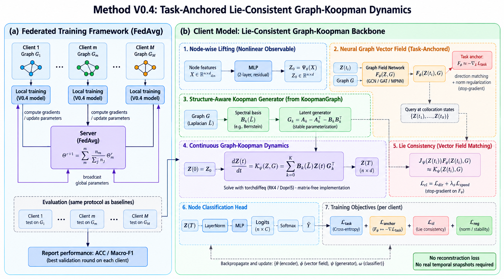

# Method V0.4：任务锚定神经场闭合的图 Koopman 动力学

!!! abstract "当前设计基线"
    V0.4 的正式定义是 **Task-Anchored Neural-Field Closed Graph-Koopman
    Dynamics**。它借鉴 KoopmanGraph 成熟的连续 generator 语义、图上
    self/neighbor 线性动力学和 JVP 形式的 Lie consistency，但不照搬其依赖真实时间
    快照的 reconstruction/rollout 训练，也不把完整软件包作为运行时依赖。

    与早期候选不同，正式 V0.4 **保留 node-wise encoder，不使用 GCN stem**；非线性
    节点变换交给 encoder，图拓扑只通过参考场和真正的 Koopman dynamics 进入。
    两层 GCN 只保留为强基线/消融，不再是 V0.4 主模型。

!!! success "实现与首轮验证状态"
    V0.4 已在独立的 `codev0/models/v04/` 中实现并通过 Gate 0。Cora 完整 local
    100 轮达到 **79.53% ± 11.69%**。原始 persistent-Adam equal FedAvg 为
    **70.77% ± 12.44%**；修复 optimizer-state mismatch 后，AdamW-reset 达到
    **79.93% ± 13.16%**，per-tensor block-v FedAdamW 达到
    **81.47% ± 8.64%**。任务差距已定位为联邦优化协议问题，但 block-v 的 Lie
    cosine 仍弱，不能解释为 Koopman 坐标对齐成功。详见[实验分析](experiments/methodv04.md)。

!!! note "当前可执行实现只保留 O4"
    O0/O1/O2/O3/O5 只作为已经完成的历史选择证据保留在实验页和日志中。当前客户端、
    服务器、配置与命令行不再提供这些协议分支；正常联邦训练固定执行 O4 block-v。

[查看 KoopmanGraph 源码审计](references/koopmangraph.md){ .md-button }
[查看 V0.4 实验分析](experiments/methodv04.md){ .md-button .md-button--primary }
[查看 V0.3 失败证据](experiments/methodv03.md){ .md-button }
[回看 V0.3](methodv03.md){ .md-button }

<figure markdown="span">
  { width="100%" }
  <figcaption>Method V0.4 总体框架。橙色参考场只在训练期提供瞬时方向，不积分第二条轨迹；紫色 Graph-Koopman ODE 是训练与推理时唯一的实际动力学。</figcaption>
</figure>

!!! note "Framework 图的实现阅读约定"
    这张图表达总体模块关系，具体实现以本页公式为准：图中参考场输入统一解释为
    物理状态 $H$，图中的一步 lifting 在实现中展开为
    $H_0=E_\theta(X)$ 与 $Z_0=[H_0,\rho_\eta(H_0)]$；Lie 左端是
    $J_\Psi(H)F_\phi(H,G)$；首版只在 $H_0$ 配点；probe、field 和 main model 分三个
    optimizer phase 隔离更新；速度项首版权重为 $0$；服务器继续沿用当前 equal
    FedAvg，而不是把图中的样本数加权公式同时引入实验。

## 1. 要解决的核心矛盾

传统 Koopman identification 假设存在按时间排列的状态：

$$
x(t_0),x(t_1),\ldots,x(t_S).
$$

Cora 的每个客户端只有一张静态图、节点特征和稀疏标签，没有可被视为真实时间的
future snapshots。若先训练一个 nonlinear ODE-GNN 产生轨迹，再让 Koopman 网络去
拟合，会形成两套动力学：教师负责定义目标，Koopman 负责模仿，最终部署和联邦共享
对象都变得含混。

V0.4 改用一个局部微分条件：如果 $\Psi$ 是 Koopman observable，物理状态上的向量场
$F$ 与 latent generator $\mathcal K$ 应满足

$$
\boxed{
J_\Psi(H)F(H,G)
\approx
\mathcal K_\psi(\Psi(H),G)
}.
$$

这只需要状态、向量场和 Jacobian-vector product，不需要下一时刻快照。但静态图也
没有已知的真实 $F$，所以 V0.4 的关键不是随意再学一个场，而是让参考场先受到独立
任务方向监督，再用 stop-gradient 把其瞬时导数作为 Koopman 闭合目标。

## 2. 一条实际轨迹、一个训练期参考

### 2.1 主 forward path

客户端 $m$ 的图记作 $G_m=(V_m,E_m)$，节点特征为
$X_m\in\mathbb R^{N_m\times d_x}$。实际训练/推理 forward 为

<div class="experiment-flow">
<div class="experiment-flow__node"><span>01</span><strong>节点状态编码</strong><small>$H_0=E_\theta(X)$，不看邻接</small></div>
<div class="experiment-flow__arrow" aria-hidden="true">→</div>
<div class="experiment-flow__node"><span>02</span><strong>状态保持提升</strong><small>$Z_0=[H_0,\rho_\eta(H_0)]$</small></div>
<div class="experiment-flow__arrow" aria-hidden="true">→</div>
<div class="experiment-flow__node"><span>03</span><strong>稳定图 Koopman ODE</strong><small>$\dot Z=\mathcal K_\psi(Z,G)$</small></div>
<div class="experiment-flow__arrow" aria-hidden="true">→</div>
<div class="experiment-flow__node"><span>04</span><strong>终态分类</strong><small>$\widehat Y=C_\omega(Z(T))$</small></div>
<div class="experiment-flow__arrow" aria-hidden="true">→</div>
<div class="experiment-flow__node"><span>05</span><strong>本地/联邦评估</strong><small>ACC、Macro-F1 与诊断门</small></div>
</div>

形式化地：

$$
H_0=E_\theta(X),\qquad
Z_0=\Psi_\eta(H_0),
$$

$$
\frac{dZ(t)}{dt}=\mathcal K_\psi(Z(t),G),
\qquad
\widehat Y=C_\omega(Z(T)).
$$

### 2.2 参考 path

训练期另有神经图向量场

$$
F_\phi(H,G)\in\mathbb R^{N\times d_h},
$$

它只回答“当前状态应朝哪个任务有利的方向运动”，不从 $H_0$ 积分到 $H(T)$，也不
产生 logits。推理时可以完全移除参考场和 probe。因此，本方法从头到尾仍只有一条
实际 forward trajectory：Graph-Koopman ODE。

## 3. 从 V0.3 到 V0.4 的结构修正

| V0.3 暴露的问题 | V0.4 修正 | 目的 |
| --- | --- | --- |
| Energy-GCN 只受 closure 牵引时可把向量场缩到零 | 参考场先由 task descent 独立锚定 | 排除零场捷径 |
| closure 梯度同时修改 reference 与 Koopman 两端 | Lie target 对 $F_\phi$ stop-gradient | 固定“老师”，只校准主模型 |
| relative MSE 在小场初始化时放大梯度 | 首版只用方向余弦 | 先学几何方向，再讨论速度 |
| scalar energy 再求梯度，容易出现退化和二阶 autograd | 直接输出向量场 | 降低优化与显存复杂度 |
| $[H,V]$ 人工构造二阶状态 | $[H,\rho(H)]$ 状态保持 observable | 提升表达力但不虚构力学 |
| 随机 generator 可能产生正实部增长 | skew minus PSD 的逐频带 generator | 从参数化上保证耗散稳定 |
| 默认高阶图滤波增加变量 | Bernstein order 首版固定 $K=1$ | 先证明最小 self/neighbor 结构 |
| 小客户端标签极少而模型过宽 | 64 维状态、32 维辅助 observable | 控制方差与过拟合 |

## 4. Node-wise state encoder

正式 V0.4 不在 encoder 中使用邻接矩阵：

$$
U=\operatorname{SiLU}(XW_1+b_1),
$$

$$
H_0=\operatorname{LayerNorm}
\left(UW_2+b_2+XW_s\right).
$$

默认 $d_h=64$，encoder width 为 $128$。若输入维度与状态维度一致，$W_s$ 可以是
identity；否则使用学习得到的线性投影。这个取舍不是忽略图结构，而是明确分工：

- encoder 负责节点特征的非线性坐标变换；
- 参考场负责产生图条件的局部任务方向；
- Koopman generator 负责唯一的图传播和连续演化。

若 encoder 和 generator 都提前做消息传递，就难以分辨性能来自图表征还是 Koopman
dynamics。两层 GCN encoder 因而进入 B1 强基线，而不是主路径。

## 5. 状态保持 observable

使用逐节点 MLP $\rho_\eta$ 扩充 observable：

$$
\boxed{
\Psi_\eta(H)=[H,\rho_\eta(H)]
}
\in\mathbb R^{N\times(d_h+d_a)}.
$$

首版 $d_h=64$、$d_a=32$，故 $d_z=96$。保留 identity block 有三点作用：

1. $\Psi$ 不可能通过把所有输出变成常数而完全坍缩；
2. Lie 导数的前 $d_h$ 维天然就是 $F_\phi(H,G)$；
3. 分类头始终能访问原始状态信息，额外 observable 只负责改善线性闭合。

其方向导数可直接写为

$$
J_\Psi(H)F
=
[F,J_\rho(H)F].
$$

首版不在拼接后再加一个对全部维度任意混合的线性层；如果需要稳定尺度，只对
$\rho(H)$ 分支单独归一化，保持 identity 语义可追踪。

## 6. 任务锚定的神经图向量场

### 6.1 场网络

定义归一化邻接 $\widehat A$。两层 residual graph field 为

$$
U_F=\operatorname{SiLU}
\left(HW_{s,1}+\widehat AHW_{n,1}+b_1\right),
$$

$$
F_{\rm raw}(H,G)
=U_FW_{s,2}+\widehat AU_FW_{n,2}.
$$

为防止场通过缩小范数降低损失，对输出做全图 RMS 归一化并单独学习尺度：

$$
r(F_{\rm raw})=
\sqrt{\frac{\|F_{\rm raw}\|_F^2}{Nd_h}+\varepsilon},
$$

$$
s_\phi=s_{\min}+\operatorname{softplus}(a_\phi),
\qquad
F_\phi=s_\phi\frac{F_{\rm raw}}{r(F_{\rm raw})}.
$$

默认 $s_\phi\approx0.1$、$s_{\min}=10^{-3}$。方向和整体速度由不同机制控制：网络
学习图条件方向，正尺度参数控制参考场幅值。

### 6.2 Probe 提供任务方向

训练期线性 probe $Q_\xi:\mathbb R^{d_h}\rightarrow\mathbb R^C$ 先在冻结状态上学习：

$$
\mathcal L_{\rm probe}
=\operatorname{CE}
\left(Q_\xi(\operatorname{sg}[H_0])_{\mathcal M_{tr}},Y_{\mathcal M_{tr}}\right).
$$

随后冻结 probe，对状态求负任务梯度：

$$
D_{\rm task}
=-
\nabla_H
\operatorname{CE}
\left(Q_\xi(H)_{\mathcal M_{tr}},Y_{\mathcal M_{tr}}\right)
\bigg|_{H=\operatorname{sg}[H_0]},
$$

并立即 detach。参考场只在训练 mask 上匹配其方向：

$$
\boxed{
\mathcal L_{\rm anchor}
=1-cos
\left(
F_\phi(H_0,G)_{\mathcal M_{tr}},
\operatorname{sg}[D_{\rm task}]_{\mathcal M_{tr}}
\right)
}.
$$

因此标签只用于构造稀疏节点上的 task descent；$F_\phi$ 的 RHS 本身从不接收标签，
并通过图消息传递学习可在其他节点查询的 label-free field。幅值匹配只作为后续可选
项，首版权重为 $0$。

## 7. Lie/JVP 闭合：借鉴 KoopmanGraph，但改造监督关系

KoopmanGraph 的 `LieConsistencyLoss` 使用
`torch.autograd.functional.jvp` 计算 observable 的 Jacobian-vector product，避免显式
构造巨大 Jacobian。V0.4 沿用这一数值机制，但把已知动力场替换为已独立锚定、且在
此阶段 stop-gradient 的参考场：

$$
D_{\rm field}
=J_{\Psi_\eta}(H)
\operatorname{sg}[F_\phi(H,G)],
$$

$$
D_K
=\mathcal K_\psi(\Psi_\eta(H),G).
$$

首版闭合目标只比较方向：

$$
\boxed{
\mathcal L_{\rm Lie-dir}
=1-cos
\left(
D_{\rm field,\mathcal M_{tr}},
D_{K,\mathcal M_{tr}}
\right)
}.
$$

实现骨架是：

```python
field_ref = field(h, graph).detach()
z, d_field = torch.autograd.functional.jvp(
    observable,
    h,
    field_ref,
    create_graph=True,
)
d_koopman = generator_rhs(z, graph)
lie_dir = 1.0 - masked_cosine(d_field, d_koopman, train_mask)
```

首版只在 $H_0$ 配点，不把 Koopman latent $Z(t)$ 直接误当作物理状态送入 $F_\phi$。
通过 Gate 后才可加入少量 detached local collocation states，并且必须先定义如何从
$Z$ 取回 identity block $H$。

方向一致不保证速度一致，因此同时记录

$$
r_{\rm speed}
=\frac{\|D_K\|_F}{\|D_{\rm field}\|_F+\varepsilon}.
$$

只有当验证集 Lie cosine 稳定超过约 $0.7$ 后，才考虑加入 log-speed loss；首版
$\lambda_{\rm speed}=0$，避免尺度项再次支配优化。

## 8. 稳定 Bernstein Graph-Koopman generator

### 8.1 图谱基

对无向图使用对称归一化邻接

$$
\widehat A=D^{-1/2}AD^{-1/2},
$$

定义

$$
L=I-\widehat A,
\qquad
\bar L=\frac{L}{2}.
$$

在无负边、$\widehat A$ 对称且标准归一化成立时，
$\operatorname{spec}(\bar L)\subseteq[0,1]$。$K$ 阶 Bernstein 基为

$$
B_k(\bar L)
=\binom Kk
\bar L^k(I-\bar L)^{K-k},
\qquad k=0,\ldots,K.
$$

这些矩阵都是 PSD，且

$$
\sum_{k=0}^{K}B_k(\bar L)=I.
$$

若改变 self-loop、归一化或允许负边，必须重新验证谱区间，不能机械套用稳定性证明。

### 8.2 逐频带稳定生成元

每个频带使用

$$
G_k=J_k-R_k,
$$

$$
J_k=A_k-A_k^\top,
\qquad
R_k=C_kC_k^\top+\gamma I,
$$

于是

$$
\operatorname{sym}(G_k)
=-C_kC_k^\top-\gamma I
\preceq-\gamma I.
$$

这里用 $C_k$ 表示可学习耗散因子，避免与图谱 Bernstein basis
$B_k(\bar L)$ 记号混淆。

Graph-Koopman RHS 为

$$
\boxed{
\mathcal K_\psi(Z,G)
=
\sum_{k=0}^{K}
B_k(\bar L)ZG_k^\top
}.
$$

首版固定 $K=1$。此时

$$
B_0(\bar L)Z=\frac12(Z+\widehat AZ),
\qquad
B_1(\bar L)Z=\frac12(Z-\widehat AZ),
$$

所以

$$
\dot Z
=ZL_{\rm self}^\top
+\widehat AZL_{\rm nbr}^\top,
$$

$$
L_{\rm self}=\frac{G_0+G_1}{2},
\qquad
L_{\rm nbr}=\frac{G_0-G_1}{2}.
$$

这与 KoopmanGraph continuous graph operator 的 one-tap self/neighbor 形式等价，但
V0.4 进一步用 Bernstein 频带和耗散参数化给出全局稳定性。

### 8.3 为什么是结构稳定，而不是“RK4 看起来没爆”

向量化后，有效生成元为

$$
G_{\rm eff}
=\sum_{k=0}^{K}B_k(\bar L)\otimes G_k.
$$

因为 $B_k(\bar L)\succeq0$、其和为 $I$，且
$\operatorname{sym}(G_k)\preceq-\gamma I$，故

$$
\operatorname{sym}(G_{\rm eff})
\preceq-\gamma I,
$$

从而

$$
\max\Re\lambda(G_{\rm eff})\le-\gamma,
\qquad
\|Z(t)\|_F\le e^{-\gamma t}\|Z(0)\|_F.
$$

默认 $\gamma=10^{-4}$，可比较 $10^{-3}$。这保证连续系统耗散，但离散 RK4 仍需满足
数值稳定区间；因此同时报告 RK4 半步误差、小图 matrix-exponential oracle 和
$\|Z(T)\|/\|Z(0)\|$，不能把参数化证明替代求解器验证。

## 9. 分类头与主目标

分类头读取完整的 $Z(T)$：

$$
\widehat Y
=W_2\operatorname{Dropout}
\left(
\operatorname{SiLU}
\left(W_1\operatorname{LayerNorm}(Z(T))\right)
\right).
$$

默认 hidden width 为 $64$，dropout 为 $0.3$。主模型目标为

$$
\mathcal L_{\rm main}
=\mathcal L_{\rm task}
+\lambda_{\rm Lie}(r)\mathcal L_{\rm Lie-dir}
+\lambda_{\rm speed}\mathcal L_{\rm speed},
$$

其中首版 $\lambda_{\rm speed}=0$。训练期总共有 probe、anchor 和 main 三类 loss，
但它们不是一次相加后对所有模块联合反传。

## 10. 三阶段隔离优化

每个客户端 local step 按固定顺序执行：

| Phase | 损失 | 更新模块 | 必须冻结/截断 |
| --- | --- | --- | --- |
| A：probe | $\mathcal L_{probe}$ | $Q_\xi$ | `H0.detach()`；其余模块不更新 |
| B：field | $\mathcal L_{anchor}$ | $F_\phi$ | encoder detached，probe frozen，task direction detached |
| C：main | $\mathcal L_{task}+\lambda_{Lie}\mathcal L_{Lie-dir}$ | encoder、observable、generator、classifier | probe 与 field 不更新；Lie target 中 field detached |

local 对照分别维护 persistent Adam：`opt_probe`、`opt_field` 和 `opt_main`。正常
联邦训练不能在全局参数覆盖后继续沿用旧客户端的一阶/二阶矩；当前默认由服务器聚合
main optimizer 的 block-mean 二阶矩，每轮重置 main 的一阶矩，并重建 field/probe
Adam。核心模块隔离关系必须由可执行诊断验证：

```text
Phase A: grad(probe) != 0; grad(main, field) = 0
Phase B: grad(field) != 0; grad(encoder, probe, main) = 0
Phase C: grad(main) != 0; grad(field, probe) = 0
```

Lie warmup 使用轮次而非 batch 临时状态：

| 轮次 | 主任务 | probe/anchor | $\lambda_{Lie}$ |
| --- | --- | --- | --- |
| 1–10 | 开启 | 开启 | $0$ |
| 11–30 | 开启 | 开启 | 线性从 $0$ 增至 $0.05$ |
| 31+ | 开启 | 开启 | 默认 $0.05$ |

只有 Lie cosine、任务精度和场非坍缩诊断同时良好时，才考虑将上限增至 $0.1$。

## 11. 与 FedAvg 的边界

V0.4 不重新发明联邦生命周期。实现必须继续使用：

```text
main.py → server → worker → client → local phases → upload
        → server equal FedAvg → broadcast → client state replacement
```

FedAvg 聚合完整 model state：encoder、observable、stable generator、classifier、
reference field 和 probe；模型聚合仍是 equal FedAvg。原始协议在覆盖模型后保留三个
客户端旧 Adam state，形成 $(\theta_{global},m_{old-local},v_{old-local})$ 错配。
控制实验确认该错配是 79→69 任务差距的主要来源。

当前 main optimizer 使用双时间尺度 FedAdamW-v：

$$
m_i^{r,0}=0,\qquad v_i^{r,0}=\bar v^r,
$$

$$
\widehat m_i^{r,k}=\frac{m_i^{r,k}}{1-\beta_1^k},\qquad
\widehat v_i^{r,k}=\frac{v_i^{r,k}}{1-\beta_2^t}.
$$

$k$ 是每轮重启的 local first-moment step，$t$ 是跨轮延续的 second-moment step。
每个 main parameter tensor 上传一个 $\operatorname{mean}(v)$ 标量；21 个 tensor 仅
增加 168 bytes。历史 full-v oracle 增加约 1.334 MB；历史全局修正在
$\alpha=0.25/0.5$ 时也未改善 mean/std/worst-client 的联合表现，因此两条路径均已
从当前实现删除。field/probe 不共享二阶矩，每轮接收全局模型后使用 fresh Adam。

local gate 的含义仍是保留完整十客户端、100 轮调度，只注释客户端收到服务器消息后
接受 global model 与 optimizer meta 的单行调用。该调用被注释时，初始化的 persistent
Adam 保持连续，不会触发 FedAdamW 重建。服务器“做了聚合”但客户端没有加载，不得
称为联邦结果。

## 12. 从 KoopmanGraph 借什么、不借什么

| 内容 | 决策 | V0.4 中的落点 |
| --- | --- | --- |
| 连续 generator 语义 | 借鉴 | `generator.py` 的 RHS，而非伪离散层 |
| continuous graph self/neighbor 公式 | 借鉴并加强 | $K=1$ Bernstein 等价式 + 稳定参数化 |
| Lie consistency 的 JVP 计算 | 借鉴 | `lie_closure.py`，不显式构造 Jacobian |
| 对称图归一化与矩阵无关传播 | 借鉴 | 稀疏 $\widehat AZ$ 和多项式基 |
| GNN encoder/decoder | 只作基线 | B1 GCN，不进入正式 V0.4 主路径 |
| snapshot pair/reconstruction/rollout | 不采用 | 静态 Cora 没有真实时间对 |
| 完整 KoopmanGraph model | 不采用 | 在 `models/v04/` 独立实现最小模块 |
| dense $Nd\times Nd$ matrix exponential | 仅小图 oracle | Cora 只用 matrix-free RHS + ODE solver |
| 外部 federated helper | 不采用 | 保留当前 Fedrated-compatible 生命周期 |

若实际复制或改写上游代码，必须固定 commit hash、保留 Apache-2.0 attribution，并在
`THIRD_PARTY_NOTICES` 中登记；仅依据公式独立实现时，也应在代码注释和论文中引用
KoopmanGraph 的具体启发位置。

## 13. 建议实现结构

V0.4 后续代码应独立位于 `codev0/models/v04/`，不得 import V0.3：

```text
models/v04/
├── encoder.py           # node-wise state encoder
├── observable.py        # Psi(H) = [H, rho(H)]
├── reference_field.py   # task-anchored graph vector field
├── spectral_basis.py    # Bernstein basis matvec
├── generator.py         # stable per-band generators + RHS
├── lie_closure.py       # JVP and masked direction loss
├── ../fed_optimizer.py  # shared split-clock FedAdamW and v aggregation primitives
├── ../fed_server.py     # shared full-model O4 server lifecycle
├── model.py             # unique Koopman forward + classifier
├── training.py          # three isolated optimizer phases
├── diagnostics.py       # gate metrics and stability checks
├── client.py
├── server.py
└── __init__.py
```

这些模块已经在当前 `codev0/models/v04/` 中实现。

## 14. 首版配置

| 参数 | 默认值 | 说明 |
| --- | ---: | --- |
| `state_dim` | 64 | 小数据集状态维度 |
| `encoder_width` | 128 | node-wise residual MLP |
| `aux_dim` | 32 | nonlinear observable 维度 |
| `observable_width` | 64 | $\rho_\eta$ hidden width |
| `field_width` | 64 | reference field width |
| `field_scale_init` | 0.1 | 初始参考速度 |
| `field_scale_min` | 0.001 | 防止零场 |
| `spectral_order` | 1 | 首版只用两个 Bernstein bands |
| `stability_gamma` | $10^{-4}$ | 最小耗散裕量 |
| `generator_low_damping_init` | $10^{-4}$ | 低频近 identity-preserving |
| `generator_high_damping_init` | $2.0$ | Cora Gate-1 在 1/2/4 中选择的低通起点 |
| `integration_time` | 1.0 | Koopman forward horizon |
| `rk4_step_size` | 0.1 | 必须配套半步检查 |
| `lie_warmup_end` | 10 | 前十轮不加 Lie |
| `lie_ramp_end` | 30 | 第 30 轮达到上限 |
| `lie_weight_max` | 0.05 | 首版上限 |
| `speed_weight` | 0 | 诊断通过前不开启 |
| `dropout` | 0.3 | 分类头 regularization |
| `local_epoch` | 1 | 保持协议不变 |
| `lr_main` | 0.003 | 主模型 FedAdamW |
| `lr_field` | 0.001 | 参考场 Adam |
| `lr_probe` | 0.003 | probe Adam |
| `weight_decay` | $10^{-4}$ | 首版统一默认 |
| 固定联邦优化协议 | O4 `fedadamw_v_block` | reset $m$，聚合 per-tensor mean $v$；无可切换分支 |

## 15. 实现测试与诊断

### 15.1 必须先过的单元测试

1. `Psi(H)` 前 $d_h$ 维与 $H$ 完全一致；
2. JVP 与小张量显式 Jacobian-vector product 数值一致；
3. Lie backward 不向 reference field 写梯度；
4. 三个 optimizer phase 的参数隔离正确；
5. $K=1$ Bernstein basis 满足 $B_0+B_1=I$；
6. $K=1$ RHS 与 one-tap self/neighbor 公式等价；
7. 每个 $\operatorname{sym}(G_k)$ 的最大特征值不高于 $-\gamma$；
8. 小图完整 $G_{eff}$ 同样满足稳定性；
9. RK4 与 matrix exponential oracle 在小图上误差受控；
10. field RMS、scale 和 task cosine 排除零场/无方向场；
11. O4 注入 block-v 后 first moment 与 local clock 均归零；
12. FedAdamW 的 local-$m$/global-$v$ bias clocks 分离；
13. block-v 的 equal/weighted 聚合与 main parameter 命名一致。

### 15.2 每轮日志

| 类别 | 至少记录 |
| --- | --- |
| Task | train loss、val/test ACC、Macro-F1、逐客户端最佳验证轮 |
| Probe/field | probe loss/acc、anchor loss、task cosine、field RMS、scale、task-direction RMS |
| Lie | loss、cosine、target/RHS RMS、speed ratio |
| Dynamics | $\|Z_0\|$、$\|Z_T\|$、norm ratio、RHS RMS、NFE |
| Stability | $G_0/G_1$ 的 max real part、symmetric-part max eigenvalue |
| Oracle | 小图 full-generator error、RK4/exp error、RK4 half-step error |
| Engineering | 显存、时间、NaN/Inf、客户端与轮次 |
| Optimizer | $m/v$ RMS、block mean、adaptive step、global-v step |

ACC 提升但 Lie cosine 接近零，说明 Koopman 叙事未成立；Lie 很好但 ACC 很低，说明
参考方向或稳定 generator 过度限制任务；ACC 与 Lie 都好但 $Z_T\approx Z_0$，说明
分类头可能绕过 dynamics。三类证据必须同时观察。

## 16. 分阶段实验门

| Gate | 运行内容 | 通过条件 |
| --- | --- | --- |
| 0 | toy graph 工程验证 | shape、梯度隔离、稳定性与求解器测试全部通过 |
| 1 | stable $K=1$ backbone，Lie=0 | 训练稳定，主任务不被 Koopman ODE 破坏 |
| 2 | probe + field anchor，Lie=0 | probe 有效、field 非零且 task cosine 明显为正 |
| 3 | Lie warmup/ramp | Lie cosine 提升且任务性能不明显退化 |
| 4 | Cora 10-client local，100 轮 | mean 接近约 80%，std 显著低于 V0.3 的 13.25 |
| 5 | 恢复 global replacement，优化联邦 optimizer state | 历史 O1/O2/O3/O4/O5 对照完成；当前实现固定 O4 |

匹配预算的最小对照矩阵为：

| 编号 | 模型 | 回答的问题 |
| --- | --- | --- |
| B0 | node-wise MLP + classifier | 没有图传播时的下限 |
| B1 | 2-layer GCN + classifier | 强图 backbone 的任务上限参考 |
| B2 | A-DGN / 当前强 ODE-GNN | 连续非线性图流参考 |
| K0 | stable $K=1$ Koopman，Lie=0 | 结构化线性图流本身的容量 |
| F0 | K0 + anchored field，Lie=0 | 参考分支是否污染主任务 |
| V04 | K0 + anchored field + Lie ramp | Lie 闭合的净贡献 |

每个 Gate 只改变一个结构变量。$K=2/3$、speed matching、更多 collocation 或复杂
classifier 都必须在 $K=1$ 正式通过后作为独立消融进入。

## 17. 禁止项与结论边界

首版不得加入：额外 teacher trajectory、重建 decoder、伪造 future snapshots、
functional map、Energy-GCN/标量能量闭合、$[H,V]$ 二阶状态、聚类/个性化 server rule、
$K>1$、operator-only federation 或 dense full-graph exponential。

即使 V0.4 local 成功，也只能支持：

1. 静态图任务可用任务锚定的瞬时场构造 Lie differential supervision；
2. 状态保持 observable 能在稳定 graph generator 中承载有用任务动力学；
3. 该参数化是进入正常 FedAvg 的可用 backbone 候选。

它不能自动证明不同客户端的 Koopman 坐标已对齐，也不能证明 operator-only averaging
优于 FedAvg。任何更强联邦结论仍需在 local Gate 通过后单独设计和验证。

## 18. 一句话总结

$$
\boxed{
\text{task descent}
\rightarrow
\text{independently anchored neural field}
\rightarrow
\text{stop-gradient Lie/JVP closure}
\rightarrow
\text{one stable Graph-Koopman forward}
}
$$

V0.4 的核心不是再造一条“真实轨迹”，而是把稀疏标签提供的局部任务下降方向蒸馏为
图条件参考场，再以该场的瞬时 Lie 导数约束唯一的、结构稳定的 Graph-Koopman
dynamics。这样既保留 KoopmanGraph 已验证成熟的连续算子机制，又针对静态联邦图
分类补上其原始 snapshot 假设无法提供的任务锚定。
