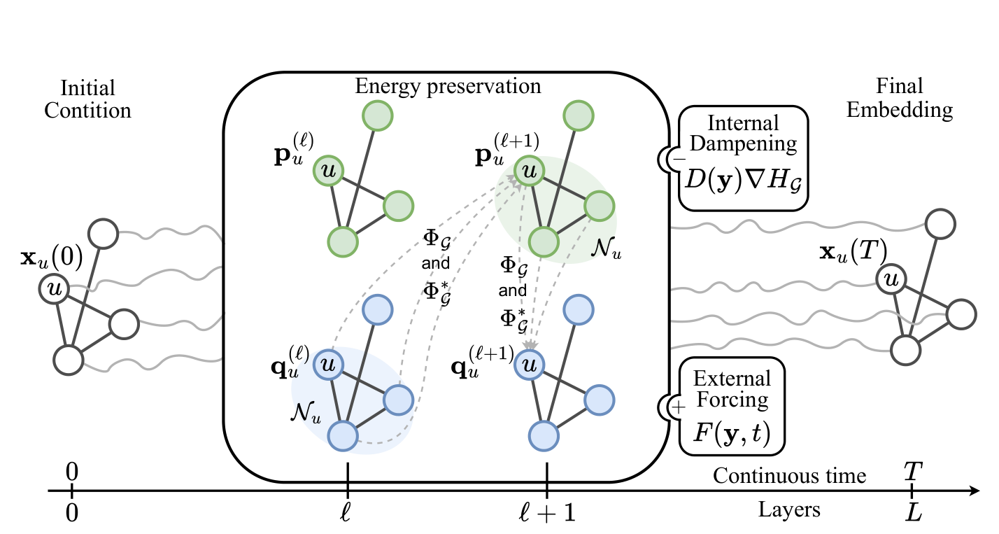

# PH-DGN：Port-Hamiltonian Architectural Bias for Long-Range Propagation in Deep Graph Networks

**作者**: Simon Heilig, Alessio Gravina, Alessandro Trenta, Claudio Gallicchio, Davide Bacciu  
**会议**: ICLR 2025  
**arXiv**: [2405.17163v2](https://arxiv.org/abs/2405.17163)  
**OpenReview**: [03EkqSCKuO](https://openreview.net/forum?id=03EkqSCKuO)  
**官方代码**: [simonheilig/porthamiltonian-dgn](https://github.com/simonheilig/porthamiltonian-dgn)  
**源码审计锚点**: `main@463b546fa16796404d857f173045ec8c80d97840`

{ width="100%" }

<figcaption class="figure-caption">原论文 Figure 1：节点状态沿连续深度传播，离散层以 $p/q$ 耦合完成图消息传递；internal dampening 与 external forcing 通过端口改变默认守恒轨迹。</figcaption>

!!! info "证据边界"
    第 1-7 节沿论文正文与附录解释 PH-DGN，第 8-16 节给出面向 PyTorch/PyG 的
    paper-faithful 最小实现指南，第 17-19 节是面向当前 GFL 项目的研究推演。
    后三节不是原论文结论，代码骨架也不是官方仓库的逐行复刻。

---

## 1. 为什么这篇论文值得重点学习

PH-DGN 的关键价值不只在于“用了 Hamiltonian”，而在于它提供了一套非常完整的 **static-graph dynamics design pattern**：

$$
\boxed{
\text{graph-coupled energy}
\rightarrow
\text{conservative neural flow}
\rightarrow
\text{damping / forcing controlled deviation}
}
$$

它解决的核心问题是：普通深层 message passing 中，远距离信息随着传播深度增加会快速衰减；如果只依赖更深的 GNN、rewiring 或全局 attention，往往是在改变通信范围，而没有直接规定“信息沿深度演化时应该如何被保存或耗散”。

PH-DGN 的回答是：

$$
\boxed{
\text{默认采用非耗散的 Hamiltonian 信息流，}
\text{再让任务学习何时耗散、何时施加额外驱动力。}
}
$$

因此，它不是简单给 ODE-GNN 套一个物理名字，而是从一个明确的 evolution principle 出发，再推导 message passing 形式，并进一步给出 Jacobian、能量守恒、divergence-free、backward sensitivity 等理论分析。

这一设计和我们当前寻找本地 backbone 的需求高度相关：我们需要的不只是“一个更复杂的 GNN”，而是一个有清楚来源的 static-graph representation dynamics。

---

## 2. 总体算法结构

给定静态图

$$
G=(V,E),
$$

每个节点 $u$ 有连续深度下的隐藏状态

$$
x_u(t)\in\mathbb R^d,
$$

全部节点堆叠为

$$
X(t)\in\mathbb R^{n\times d}.
$$

这里的 $t$ 不是现实时间，而是 **continuous propagation depth**。网络完成的是

$$
X(0)\rightarrow X(t)\rightarrow X(T).
$$

PH-DGN 把每个节点状态拆成两个耦合子状态：

$$
\boxed{
x_u(t)=\big(p_u(t),q_u(t)\big)
}
$$

其中

$$
p_u,q_u\in\mathbb R^{d/2}.
$$

$p,q$ 借用 Hamiltonian mechanics 中 momentum / position 的记号，但在 GNN 中它们只是两个相互耦合的 hidden-state blocks，并不是真实物理量。

整个方法可压缩为：

$$
\boxed{
X
\xrightarrow{\text{encoder}}
(p^0,q^0)
\xrightarrow{\text{Port-Hamiltonian graph flow}}
(p^L,q^L)
\xrightarrow{\text{readout}}
\hat Y
}
$$

中间的 graph flow 由三类成分组成：

$$
\boxed{
\underbrace{J\nabla H_G}_{\text{conservative transport}}
-
\underbrace{R\nabla H_G}_{\text{damping / internal regulation}}
+
\underbrace{F}_{\text{external forcing}}
}
$$

### 符号与张量维度

| 符号 | 维度 | 含义 |
| --- | --- | --- |
| $n$ | 标量 | 图中的节点数 |
| $d$ | 偶数 | 每个节点的完整隐藏维度 |
| $h=d/2$ | 标量 | momentum/position 子空间宽度 |
| $X(t)$ | $n\times d$ | 全部节点在连续深度 $t$ 的状态矩阵 |
| $y(t)=\operatorname{vec}(X(t))$ | $nd$ | 全图状态的向量化表示 |
| $p(t),q(t)$ | $n\times h$ | 两个相互耦合的节点状态块 |
| $H_G(y)$ | 标量 | 显式包含邻域聚合的 graph Hamiltonian |
| $W,V$ | $d\times d$ | self 与 neighbor 通道权重；显式离散化时取 block diagonal |
| $J$ | $nd\times nd$ | 固定 skew-symmetric coupling matrix |
| $D(q)$ | $h\times h$，或逐节点 $n\times h$ 对角系数 | internal damping/acceleration |
| $F(q,t)$ | $n\times h$ | state/time-dependent external forcing |
| $L,\epsilon,T=L\epsilon$ | 标量 | 离散层数、步长和总传播深度 |

---

## 3. Conservative message passing：从能量函数推导图传播

### 3.1 全局 Hamiltonian dynamics

纯守恒版本从标准 Hamiltonian ODE 出发：

$$
\boxed{
\frac{dy(t)}{dt}=J\nabla H_G(y(t))
}
$$

其中 $y(t)$ 是所有节点状态的向量化结果，$H_G$ 是 graph Hamiltonian，$J$ 为固定 skew-symmetric matrix：

$$
J=
\begin{pmatrix}
0 & -I\\
I & 0
\end{pmatrix}.
$$

因为 $J^\top=-J$，Hamiltonian flow 不沿负梯度下降，而是在能量面上产生旋转式演化。

从节点角度：

$$
\boxed{
\dot p_u=-\nabla_{q_u}H_G,
\qquad
\dot q_u=\nabla_{p_u}H_G
}
$$

这就是论文 Fig.1 中 $p,q$ 两条状态流交叉耦合的来源。

---

### 3.2 Graph Hamiltonian

真正把普通 Hamiltonian 变成 graph dynamics 的关键，是把 neighborhood aggregation 写入能量函数：

$$
H_G(y)
=
\sum_{u\in V}
\widetilde\sigma
\left(
Wx_u+
\Phi_G(\{x_v\}_{v\in N_u})+b
\right)^\top\mathbf 1_d.
$$

可先定义节点 pre-activation：

$$
a_u=Wx_u+\Phi_G(\{x_v\}_{v\in N_u})+b.
$$

则全局能量就是

$$
H_G=\sum_u \widetilde\sigma(a_u)^\top\mathbf 1.
$$

其中 $\widetilde\sigma$ 是 $\sigma$ 的原函数：

$$
\frac{d\widetilde\sigma(z)}{dz}=\sigma(z).
$$

这个设计的目的很直接：后续对能量求梯度时，$\widetilde\sigma$ 自动变回普通神经网络激活函数 $\sigma$。

因此，能量不是与图结构无关的黑箱 MLP，而是显式编码

$$
\boxed{
\text{self-state}+\text{neighbor aggregation}.
}
$$

---

### 3.3 为什么求能量梯度会自然产生 message passing

对节点 $x_u$ 求

$$
\nabla_{x_u}H_G
$$

时会出现两类影响。

第一类来自节点自身 energy：

$$
W^\top\sigma(a_u).
$$

第二类来自“节点 $u$ 出现在其他节点的 neighborhood aggregation 中”，因此 $x_u$ 也会影响邻居的 energy。该部分可概念化为

$$
\Phi_G^*.
$$

所以节点 vector field 可写为

$$
\boxed{
\dot x_u
=
J_u
\left[
W^\top\sigma(a_u)+\Phi_G^*
\right].
}
$$

这里：

- $\Phi_G$：邻居状态如何进入节点的 forward aggregation；
- $\Phi_G^*$：该 aggregation 对 energy gradient 产生的 reverse / adjoint influence。

原论文给出的简单 aggregation 示例是

$$
\boxed{
\Phi_G(\{x_v\}_{v\in N_u})
=
\sum_{v\in N_u}Vx_v.
}
$$

于是，若 $u\in N_v$，那么

$$
\frac{\partial \Phi_G(N_v)}{\partial x_u}=V,
$$

对应 reverse influence：

$$
V^\top\sigma(a_v).
$$

因此可以把 energy gradient 理解成：

$$
\boxed{
\nabla_{x_u}H_G
=
\text{self response}
+
\text{responses of graph-coupled neighbors}.
}
$$

这一步非常重要：**message passing 不是先人工设计再做动力学解释，而是由 graph energy 的梯度自然推导出来。**

---

## 4. Purely conservative PH-DGN 为什么能做 long-range propagation

原论文从多个角度说明纯 Hamiltonian graph flow 是 non-dissipative 的。

### 4.1 Jacobian 谱性质

对 conservative vector field 求 Jacobian。由于 Hamiltonian Hessian 是 symmetric，而 $J$ 是 skew-symmetric，作者证明 Jacobian 特征值实部为零：

$$
\boxed{
\operatorname{Re}(\lambda_i)=0.
}
$$

因此系统没有天然的指数衰减项；局部扰动更接近旋转 / 振荡，而不是不断收缩。

---

### 4.2 能量守恒与 divergence-free

因为

$$
\dot y=J\nabla H_G,
$$

所以

$$
\frac{dH_G}{dt}
=
\nabla H_G^\top J\nabla H_G
=0.
$$

即

$$
\boxed{
H_G(y(t))=H_G(y(0)).
}
$$

同时作者证明 vector field divergence-free：

$$
\boxed{
\nabla\cdot\big(J\nabla H_G\big)=0.
}
$$

这说明 propagation flow 不会把状态持续压缩到越来越小的表示区域。

---

### 4.3 Backward sensitivity

作者进一步考察：最终节点状态对过去自身状态是否仍有敏感性：

$$
\frac{\partial x_u(T)}{\partial x_u(T-t)}.
$$

并证明其矩阵范数存在下界：

$$
\boxed{
\left\|
\frac{\partial x_u(T)}{\partial x_u(T-t)}
\right\|
\ge 1.
}
$$

因此早期状态对最终表示的影响不会自然衰减到零，这为 non-vanishing gradient 和 long-range memory 提供理论依据。

这里要注意：论文的理论目标是 **long-range propagation**，不等于“所有任务都应该完全守恒”。这正是下一步引入 port-Hamiltonian driving forces 的原因。

---

## 5. Port-Hamiltonian：允许任务主动偏离守恒轨迹

纯 Hamiltonian 的问题是过于严格：

$$
\frac{dH_G}{dt}=0
$$

意味着系统原则上不允许主动忘记信息。

真实任务却可能需要：

- 抑制噪声；
- 丢掉无关邻居信息；
- 增强特定表示方向；
- 由任务信号把 trajectory 推向更有判别性的区域。

因此完整 PH-DGN 写成：

$$
\boxed{
\frac{dx_u}{dt}
=
\left[
J_u-
\begin{pmatrix}
D(q)&0\\
0&0
\end{pmatrix}
\right]
\nabla_{x_u}H_G
+
\begin{pmatrix}
F(q,t)\\
0
\end{pmatrix}
}
$$

等价地：

$$
\boxed{
\dot p_u
=-\nabla_{q_u}H_G
-D(q)\nabla_{p_u}H_G
+F(q,t)
}
$$

$$
\boxed{
\dot q_u
=\nabla_{p_u}H_G.
}
$$

---

### 5.1 Internal dampening $D(q)$

如果

$$
D(q)\succeq0,
$$

则它产生能量耗散。忽略 external force 时：

$$
\frac{dH_G}{dt}
=
-
(\nabla_pH_G)^\top
D(q)
(\nabla_pH_G)
\le0.
$$

因此 $D$ 可以理解为：

$$
\boxed{
\text{learned internal information regulation}.
}
$$

若 $D$ 为 PSD，就是 damping；若 $D$ 为 NSD，可产生 acceleration；若符号混合，则不同 hidden directions 可以有不同增减行为。

---

### 5.2 External forcing $F(q,t)$

External force 不再只调整已有 Hamiltonian flow，而是直接给 trajectory 加一个新的驱动力：

$$
\boxed{
F(q,t)=\text{state/time-dependent external control}.
}
$$

完整能量变化可概念化为：

$$
\boxed{
\frac{dH_G}{dt}
=
-
(\nabla_pH_G)^\top D(\nabla_pH_G)
+
(\nabla_pH_G)^\top F.
}
$$

因此：

- conservative term 决定默认 transport；
- damping 决定内部需要遗忘 / 抑制多少；
- forcing 决定外部需要把轨迹推向哪里。

这正是 Port-Hamiltonian 相比纯 Hamiltonian 更适合一般学习任务的地方。

---

## 6. 离散化：为什么不能直接普通 Euler

Hamiltonian 系统的结构不应该被随意的 numerical solver 破坏。原论文采用 **Symplectic Euler**。

在纯守恒版本中，先更新 $p$，再用新 $p$ 更新 $q$：

$$
p_u^{(\ell+1)}
=
p_u^{(\ell)}
-
\epsilon\nabla_{q_u}H_G,
$$

$$
q_u^{(\ell+1)}
=
q_u^{(\ell)}
+
\epsilon\nabla_{p_u}H_G
\big|_{p^{(\ell+1)}}.
$$

在论文对 $W,V$ 使用 block-diagonal 结构后，这两个梯度都可以写成显式 message-passing 公式。因此 PH-DGN 最终不需要把整个模型作为 black-box NeuralODE 交给通用 `torchdiffeq` 求解；可以直接实现为一系列结构保持的 graph layers。

这也是原论文代码实现非常值得借鉴的一点：**physics-inspired structure 最终被编译成 explicit graph message-passing update，而不是依赖高开销的自动求 Hamiltonian gradient + ODE solver。**

!!! note "论文公式与官方代码采用两种 Symplectic Euler 顺序"
    论文 Appendix A.3 的 Eq. (12)-(13) 先计算
    $p^{(\ell+1)}$，再用新 $p^{(\ell+1)}$ 计算 $q^{(\ell+1)}$。
    当前官方 `PortHamiltonianConv.forward` 则先更新 (q)，再用新 (q) 更新
    (p)。二者是 Symplectic Euler 的两种共轭变体，但 forward 数值轨迹并不逐步
    相同。下文骨架遵循论文公式；复刻官方实验时必须改用官方代码顺序。

---

## 7. 官方实现中可选的 dissipative components

论文 Appendix A.2 给出多种 $D$ 和 $F$ 的实现。

### Dampening $D(q)$

1. `param`：直接学习一个对角向量；允许正负值，因此既可 damping 也可 acceleration。
2. `param+`：learnable vector + ReLU，使对角项非负，对应 PSD damping。
3. `MLP4-ReLU`：根据 $q$ 通过 4-layer MLP 产生状态依赖 damping。
4. `DGN-ReLU`：使用 graph aggregation 产生节点依赖 damping。

### External forcing $F(q,t)$

1. `MLP4-Sin`：输入 $(q,t)$，使用多层 MLP + sin activation。
2. `DGN-tanh`：通过 graph message passing + tanh 生成 external force。

原论文的经验结果说明：driving forces 并非永远有益。需要完整保存信息的任务可能更适合 purely conservative PH-DGNC；而需要过滤 / 改写信息的任务，完整 PH-DGN 往往更有效。

所以正确理解不是“damping + forcing 越多越好”，而是：

$$
\boxed{
\text{model selection determines how far to deviate from conservation.}
}
$$

---

## 8. 代码实现：建议的模块拆分

官方仓库按实验任务分别组织：

```text
porthamiltonian-dgn/
├── graph_prop_pred/
│   ├── models/
│   ├── conf.py
│   ├── main.py
│   └── run_all.sh
├── graph_transfer_task/
├── lrgb/
├── minesweeper/
└── env.yml
```

官方 README 给出的主要环境为：

```text
Python 3.8.18
PyTorch 2.1.0
PyG 2.4.0
CUDA 12.1
```

对我们自己的 backbone，不建议照搬其“每个 benchmark 一套 models”组织，而建议抽出一个最小、可诊断的统一实现：

```text
ph_backbone/
├── encoder.py
├── graph_energy.py
├── conservative_flow.py
├── damping.py
├── forcing.py
├── symplectic_layer.py
├── model.py
├── diagnostics.py
└── tests/
```

其中：

- `graph_energy.py`：只定义由 $W,V,\Phi_G,\sigma$ 对应的 energy-gradient building blocks；
- `conservative_flow.py`：实现 $\nabla_pH_G,\nabla_qH_G$；
- `damping.py`：实现 `none / param / param+ / MLP / DGN`；
- `forcing.py`：实现 `none / MLP / DGN`；
- `symplectic_layer.py`：严格负责 $p\rightarrow q$ 的 Symplectic Euler update；
- `diagnostics.py`：记录 energy drift、state norm、gradient sensitivity、damping / force magnitude。

---

## 9. 核心 PyTorch/PyG 实现骨架

下面代码不是逐行复刻官方仓库，而是根据论文公式整理出的 **paper-faithful minimal implementation skeleton**，适合嵌入现有本地 backbone。实现时应优先和官方代码逐项核对 edge orientation、self-loop 和 normalization 细节。

### 9.1 基础 aggregation

以下假设 PyG 的 `edge_index[0]` 是 source，`edge_index[1]` 是 target，并且无向图已经存成双向边。

```python
import torch
import torch.nn as nn
from torch_scatter import scatter_add


def aggregate_messages(x, edge_index, linear, num_nodes):
    src, dst = edge_index
    msg = linear(x[src])
    return scatter_add(msg, dst, dim=0, dim_size=num_nodes)
```

对于

$$
\Phi_G(N_u)=\sum_{v\in N_u}Vx_v,
$$

forward aggregation 就是把 $Vx_v$ 按 target 节点求和。

---

### 9.2 Energy gradient block

对

$$
a_u=Wx_u+\sum_{v\in N_u}Vx_v+b
$$

有

$$
\nabla_{x_u}H_G
=
W^\top\sigma(a_u)
+
\sum_{v:u\in N_v}V^\top\sigma(a_v).
$$

对应实现：

```python
class GraphHamiltonianGradient(nn.Module):
    def __init__(self, dim, activation=torch.tanh):
        super().__init__()
        self.W = nn.Linear(dim, dim, bias=False)
        self.V = nn.Linear(dim, dim, bias=False)
        self.bias = nn.Parameter(torch.zeros(dim))
        self.activation = activation

    def forward(self, x, edge_index):
        n = x.size(0)
        src, dst = edge_index

        # Phi_G: neighbors -> current node
        phi = aggregate_messages(x, edge_index, self.V, n)

        pre = self.W(x) + phi + self.bias
        response = self.activation(pre)

        # self contribution: W^T sigma(a_u)
        grad_self = response @ self.W.weight

        # reverse / adjoint influence:
        # if edge src=u -> dst=v, x_u appears in energy term of v.
        # contribution to u is V^T sigma(a_v).
        reverse_msg = response[dst] @ self.V.weight
        grad_reverse = scatter_add(
            reverse_msg, src, dim=0, dim_size=n
        )

        return grad_self + grad_reverse
```

注意：

1. 这段代码直接实现论文推导后的 gradient，不需要显式构造 scalar $H_G$ 再用 `autograd.grad`；
2. 对无向图，应确认 `edge_index` 已包含双向边；
3. 若使用 GCN normalization / self-loop，必须和主工程的数据预处理保持一致；
4. `grad_reverse` 的 edge orientation 是最容易实现错的地方，必须写 unit test 与自动求导版本对照。

---

## 10. p/q 耦合与 Symplectic Euler

为与论文 Appendix A.3 对齐，将 $p,q$ 分别使用独立参数：

$$
(W_p,V_p,b_p),
\qquad
(W_q,V_q,b_q).
$$

纯 conservative update：

```python
class ConservativePHLayer(nn.Module):
    def __init__(self, half_dim, step_size=0.1):
        super().__init__()
        self.grad_p = GraphHamiltonianGradient(half_dim)
        self.grad_q = GraphHamiltonianGradient(half_dim)
        self.eps = step_size

    def forward(self, p, q, edge_index):
        # p_{l+1} = p_l - eps * dH/dq
        dH_dq = self.grad_q(q, edge_index)
        p_next = p - self.eps * dH_dq

        # q_{l+1} = q_l + eps * dH/dp evaluated at p_{l+1}
        dH_dp = self.grad_p(p_next, edge_index)
        q_next = q + self.eps * dH_dp

        return p_next, q_next
```

这段结构最重要的不是“两个 GNN 串起来”，而是更新顺序：

$$
\boxed{
p^{\ell}\rightarrow p^{\ell+1}\rightarrow q^{\ell+1}
}
$$

它体现的是 symplectic integration，而不是普通 simultaneous residual update。

---

## 11. Damping 模块

最适合作为第一版实验的是 **对角 PSD damping**，因为简单、稳定、容易解释。

```python
class PositiveDiagonalDamping(nn.Module):
    def __init__(self, dim, init=-3.0):
        super().__init__()
        self.raw = nn.Parameter(torch.full((dim,), init))

    def forward(self, q):
        # softplus 比 ReLU 更不容易形成 exact-zero dead zone
        d = torch.nn.functional.softplus(self.raw)
        return d.unsqueeze(0).expand_as(q)
```

对应

$$
D=\operatorname{diag}(d),
\qquad d\ge0.
$$

作用于 gradient 时不需要真的构造 $d\times d$ 矩阵：

```python
damping_term = d * dH_dp
```

对于当前项目尤其建议避免一开始使用

$$
D=CC^\top
$$

这种在 $C\approx0$ 时梯度也趋近 0 的参数化，因为 V0.4 已经观察到类似 one-way ratchet / absorbing-zero 问题。第一版最好使用 `softplus(raw)` 或直接可学习 scalar / diagonal damping，使“从弱 damping 学到强 damping”在优化上是可达的。

---

## 12. External forcing 模块

先给出最简单的 local forcing：

```python
class LocalForcingMLP(nn.Module):
    def __init__(self, dim, hidden_dim=None):
        super().__init__()
        hidden_dim = hidden_dim or dim
        self.net = nn.Sequential(
            nn.Linear(dim + 1, hidden_dim),
            nn.Tanh(),
            nn.Linear(hidden_dim, dim),
        )

    def forward(self, q, t):
        if not torch.is_tensor(t):
            t = q.new_tensor(float(t))
        t_col = t.expand(q.size(0), 1)
        return self.net(torch.cat([q, t_col], dim=-1))
```

原论文使用的具体选项包括 `MLP4-Sin` 和 `DGN-tanh`。第一版不需要立刻复刻所有版本；建议先保证接口稳定：

```python
force = forcing(q, t, edge_index, external_context=None)
```

这样未来联邦阶段可以把 `external_context` 换成其他客户端 / 服务端提供的知识，而无需重写 PH layer。

---

## 13. 完整 Port-Hamiltonian layer

推荐接口：

```python
class PortHamiltonianLayer(nn.Module):
    def __init__(
        self,
        half_dim,
        step_size=0.1,
        damping=None,
        forcing=None,
    ):
        super().__init__()
        self.grad_p = GraphHamiltonianGradient(half_dim)
        self.grad_q = GraphHamiltonianGradient(half_dim)
        self.eps = step_size
        self.damping = damping
        self.forcing = forcing

    def forward(self, p, q, edge_index, t=0.0, external_context=None):
        # Gradients at the current state
        dH_dq = self.grad_q(q, edge_index)
        dH_dp_current = self.grad_p(p, edge_index)

        # Internal regulation
        if self.damping is None:
            damp = 0.0
        else:
            d = self.damping(q)
            damp = d * dH_dp_current

        # External control
        if self.forcing is None:
            force = 0.0
        else:
            force = self.forcing(
                q, t,
                # keep these interfaces for future federated forcing
                # edge_index=edge_index,
                # external_context=external_context,
            )

        # p update
        p_next = p + self.eps * (-dH_dq - damp + force)

        # symplectic q update uses new p
        dH_dp_next = self.grad_p(p_next, edge_index)
        q_next = q + self.eps * dH_dp_next

        return p_next, q_next
```

### 关于 full PH 离散化的一个实现注意点

原论文 Eq.(14) 的 driven update 中，state-dependent damping 写成 $D(q^{\ell+1})$，因此严格形式可能带来半隐式依赖；对于 state-independent `param/param+` 不存在这个问题。若要完整复刻 `MLP/DGN` state-dependent damping，应以官方代码具体实现为准，不应自行假设其求解方式。

因此本项目第一版建议：

$$
\boxed{
D=\text{state-independent scalar/diagonal}
}
$$

先验证 dynamics principle，再升级到 $D(q)$。

---

## 14. Backbone 封装

完整节点分类 backbone 可以保持非常简单：

```python
class PHDGNBackbone(nn.Module):
    def __init__(self, in_dim, hidden_dim, out_dim,
                 num_steps=8, step_size=0.1,
                 use_damping=True, use_forcing=False):
        super().__init__()
        assert hidden_dim % 2 == 0
        h = hidden_dim // 2

        self.encoder = nn.Linear(in_dim, hidden_dim)

        damping = PositiveDiagonalDamping(h) if use_damping else None
        forcing = LocalForcingMLP(h) if use_forcing else None

        self.flow = PortHamiltonianLayer(
            h,
            step_size=step_size,
            damping=damping,
            forcing=forcing,
        )

        self.num_steps = num_steps
        self.readout = nn.Linear(hidden_dim, out_dim)

    def forward(self, x, edge_index):
        h0 = self.encoder(x)
        p, q = h0.chunk(2, dim=-1)

        for l in range(self.num_steps):
            t = l * self.flow.eps
            p, q = self.flow(p, q, edge_index, t=t)

        hT = torch.cat([p, q], dim=-1)
        logits = self.readout(hT)
        return logits, {"p": p, "q": q, "h0": h0, "hT": hT}
```

第一版训练目标只需要普通 supervised CE：

$$
\mathcal L_{task}=\operatorname{CE}(\hat Y,Y).
$$

不要一开始再叠加 Lie closure、Koopman loss、energy regularization、cross-client loss。先验证 PH dynamics 自身有没有本地表达能力。

---

## 15. 必须实现的 diagnostics

PH-DGN 的优势之一是很多内部量可以直接诊断。因此本地 backbone 不能只记录 ACC。

建议每轮 / 每若干 epoch 记录：

### 15.1 State evolution

$$
\|p^\ell\|_F,
\qquad
\|q^\ell\|_F,
\qquad
\|H^\ell-H^0\|_F.
$$

### 15.2 Conservative gradient magnitude

$$
\|\nabla_qH_G\|_F,
\qquad
\|\nabla_pH_G\|_F.
$$

### 15.3 Damping magnitude

$$
\|D\nabla_pH_G\|_F.
$$

并记录每个通道 $d_j$，检查是否发生全部坍缩为 0 或全部增大。

### 15.4 Force magnitude

$$
\|F(q,t)\|_F.
$$

以及相对于 conservative flow 的比例：

$$
r_F
=
\frac{\|F\|_F}
{\|J\nabla H_G\|_F+\epsilon}.
$$

### 15.5 Energy drift

若实现显式 $H_G$ 计算，pure conservative 模式应监控：

$$
\Delta E_\ell
=
H_G(y^\ell)-H_G(y^0).
$$

离散系统不会绝对精确守恒，但 symplectic integration 应保持有界、非系统性漂移。

### 15.6 Gradient sensitivity

小规模实验可测：

$$
\left\|
\frac{\partial x^L_u}{\partial x^\ell_u}
\right\|.
$$

不需要训练时每轮都算，但应作为 backbone sanity check。

---

## 16. 最小消融顺序

为了避免再次出现“模块太多、性能不行但不知道是谁造成的”，建议 PH backbone 必须按下面顺序逐级增加：

```text
P0  Encoder + Readout                  # no propagation sanity baseline
P1  Pure Hamiltonian / PH-DGNC        # J∇H only
P2  P1 + scalar damping               # one learnable δ
P3  P1 + diagonal damping             # channel-wise δ_j
P4  P3 + local forcing                # F_local(q,t)
P5  P4 + graph-conditioned forcing    # optional
```

每一级必须和 GCN / 当前 V0.4 backbone 在同一划分、同一训练 protocol 下比较。

**Koopman 暂时不进入 P0–P5。**

原因不是否定 Koopman，而是先回答：

$$
\boxed{
\text{Port-Hamiltonian evolution principle 本身是否足以形成强 local backbone？}
}
$$

只有这个问题回答清楚以后，才判断是否需要 Koopman 作为 compact dynamics proxy。

---

## 17. 对我们 GFL 项目的研究映射（非原论文）

下面是从 PH-DGN 向当前项目的推演，不属于原论文内容。

### 17.1 p/q 耦合可以成为“特征—结构交互”的技术入口

我们使用 dynamics 的原始动机之一，是传统 GFL 往往把 feature heterogeneity 和 topology/propagation heterogeneity 分开处理，却忽略二者在传播过程中的相互耦合。

PH-DGN 的

$$
\boxed{
p\leftrightarrow q
}
$$

提供了一个天然的双状态 coupled dynamics template。

但必须强调：**原论文没有把 $p$ 解释成 feature、$q$ 解释成 structure。**

如果我们这样使用，需要自己重新定义语义。例如可以研究：

$$
p_m(t)=\text{semantic / feature state},
$$

$$
q_m(t)=\text{graph-conditioned propagation state},
$$

并通过统一 energy

$$
E_m(p_m,q_m;A_m)
$$

让二者互相驱动：

$$
\dot p_m=-\nabla_{q_m}E_m,
\qquad
\dot q_m=\nabla_{p_m}E_m.
$$

真正的创新点不能只是“改名”，而必须设计出 $E_m$ 如何把 feature state 与 graph coupling 同时编码进去，并通过实验验证这种 coupling 比单流 ODE 有必要。

---

### 17.2 External forcing 是非常自然的 federation 接口

原论文的 $F(q,t)$ 表示“系统外部施加的作用”。在联邦场景里，可以自然重新解释为：

$$
\boxed{
F_m^{fed}(t)=
\text{other clients / server 对 client }m\text{ 本地 dynamics 的外部作用}
}
$$

于是客户端动力学可写成：

$$
\boxed{
\dot y_m
=
(J-R_m)\nabla E_m(y_m)
+
F_m^{fed}(y_m,t).
}
$$

这比直接把所有客户端模型平均为同一个参数更符合个性化 GFL：

- $E_m$ / local conservative field 保留本地动力学；
- $R_m$ 决定本地需要吸收 / 忘记多少；
- $F_m^{fed}$ 才承载跨客户端可迁移知识。

这与当前“knowledge flow”目标高度一致。

---

### 17.3 Hamiltonian / Port-Hamiltonian 可以提供联邦知识流的守恒语言

如果未来希望把“知识在客户端间流动直到平衡”写成真正的守恒系统，可以不只说“external force 来自其他客户端”，而进一步约束客户端间成对作用满足某种平衡关系。

例如定义客户端 $n\rightarrow m$ 的 interaction force：

$$
F_{n\rightarrow m},
$$

并要求成对满足某种 antisymmetric / power-balanced relation，使全局交换项不凭空创造知识能量：

$$
\sum_m
\nabla E_m^\top F_m^{fed}
\approx0.
$$

此时：

- 客户端内部 damping 表示本地耗散；
- 客户端间 forcing 表示跨系统能量 / 知识交换；
- 全局平衡态对应 net forcing 逐渐趋近 0。

这比当前单纯“距离小就聚合、距离大就 gate”更接近我们想要的 dynamical knowledge-flow storyline。

但这里需要后续严格设计；仅把 $F$ 命名为 federation force 并不能自动得到守恒理论。

---

### 17.4 Koopman 不再必须是 backbone 的核心

如果 PH dynamics 本身已经提供：

1. 清晰的 local evolution principle；
2. compact / interpretable 的 energy、damping、forcing components；
3. 联邦作用可以直接通过 external port 进入；

那么未必一定需要再强制学习一个低秩 Koopman operator。

后续可以保留两条路线：

### Route A：PH-first，不使用 Koopman

$$
\text{Local PH dynamics}
+
\text{Federated external forcing}.
$$

通信对象可以是 force generator、energy descriptor、低维 interaction coefficient 等，而不是 $K_m$。

### Route B：PH dynamics + Koopman compression

$$
\text{PH-DGN produces nonlinear trajectory}
\rightarrow
\text{Koopman/EDMD compresses trajectory}
\rightarrow
\text{federation exchanges compact proxy}.
$$

此时 Koopman 的角色非常清楚：

$$
\boxed{
\text{它只是 dynamics compressor，不负责定义 dynamics。}
}
$$

是否需要 Route B，应由通信量、隐私、跨客户端可比性以及实际性能决定，而不是为了保留已有技术路线而强行加入。

---

## 18. 与 GREAD / TANGO / Koopman 的位置关系

当前可以把几类技术重新排成更清楚的层次：

| 技术 | 回答的问题 | 适合承担的角色 |
|---|---|---|
| GREAD | static graph 中 smoothing 与 reaction 如何平衡 | 提供 reaction-diffusion evolution principle |
| TANGO | 如何从 learnable energy 产生下降 + tangential flow | 提供 energy-induced nonlinear field |
| PH-DGN | 信息如何在 conservation / dissipation / forcing 间平衡 | 当前最值得优先研究的 dynamics backbone template |
| Koopman | 如何把 nonlinear trajectory 压缩成线性低维代理 | 可选的 communication / dynamics compression layer |

因此，下一阶段不应该把四种方法全部堆在一起。

更合理的研究顺序是：

$$
\boxed{
\text{先选定一个有原则的 local graph dynamics}
\rightarrow
\text{验证本地性能和机制}
\rightarrow
\text{再决定 federation 通过 forcing 还是 Koopman proxy 接入}
}
$$

PH-DGN 当前最值得学习的是三点：

1. **graph energy 产生 message passing dynamics**；
2. **p/q coupled state** 提供双状态交互模板；
3. **external forcing 是天然的外部系统接口**。

---

## 19. 当前建议的第一阶段实现目标

第一阶段不要直接做联邦创新，也不要立即接 Koopman。目标是做一个干净的 `PH-DGN local backbone`：

$$
X
\rightarrow
(p^0,q^0)
\rightarrow
\text{PH flow}
\rightarrow
(p^T,q^T)
\rightarrow
\hat Y.
$$

要求：

- 保持当前 FedAvg / 数据划分 / best-val paired test protocol 不变；
- 只替换 local model backbone；
- 第一版先实现纯 conservative + scalar/diagonal damping；
- forcing 接口先留好，但先不开；
- 暂不加入 Koopman；
- 必须同时输出内部 dynamics diagnostics；
- 与 GCN、现有 V0.4、A-DGN backbone 做严格相同协议比较。

只有当这个 backbone 在真实节点分类任务上能够达到或超过当前基线，且 diagnostics 证明 dynamics 不是退化成普通 GCN/filter，才进入下一阶段：

$$
\boxed{
F_m^{fed}
=
\text{cross-client external forcing}
}
$$

并研究跨客户端 Port-Hamiltonian knowledge flow。

---

## 20. 参考来源

- Heilig et al., **Port-Hamiltonian Architectural Bias for Long-Range Propagation in Deep Graph Networks**, ICLR 2025，[arXiv:2405.17163](https://arxiv.org/abs/2405.17163)，[OpenReview](https://openreview.net/forum?id=03EkqSCKuO)。
- Official implementation: [simonheilig/porthamiltonian-dgn](https://github.com/simonheilig/porthamiltonian-dgn)
- 官方 README 显示代码覆盖 Graph Property Prediction、Graph Transfer、LRGB、Minesweeper 四类实验，并提供 `models / conf.py / main.py` 等复现实验入口。
